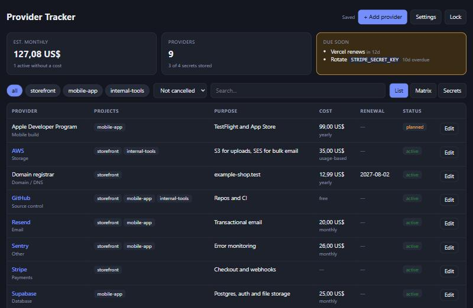
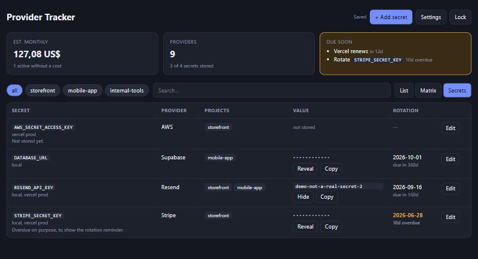
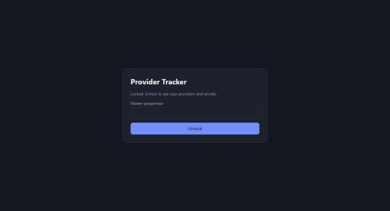
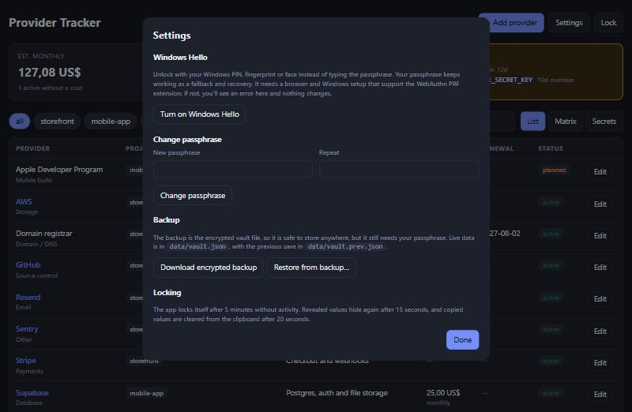

# Provider Vault

A small local-first app for keeping track of the third-party services behind your projects
(hosting, databases, payments, email, and so on): what each one costs, when it renews, and which
project uses it. It also includes an **encrypted secrets vault**, so API keys never sit in a
spreadsheet or a plain-text file.

|                                 Providers                                 |                             Secrets                             |
| :-----------------------------------------------------------------------: | :-------------------------------------------------------------: |
|  |  |

|                   Locked                    |                                   Settings                                    |
| :-----------------------------------------: | :---------------------------------------------------------------------------: |
|  |  |

All data in the screenshots is fictional.

## Features

- **Providers:** cost (monthly or yearly, normalised to a monthly total), billing period, renewal
  date, status (active, planned, trial, cancelled), and which projects use it.
- **Views:** filter by project, status or text; a matrix of providers against projects; a
  "due soon" card for upcoming renewals and overdue secret rotations.
- **Secrets:** store values per provider and project, with a rotation schedule. Values are masked,
  revealed for 15 seconds on request, and copied values are cleared from the clipboard after 20
  seconds.
- **Encrypted at rest:** everything is stored in one encrypted file. A master passphrase unlocks
  it, and the app locks itself after 5 minutes idle.
- **Optional Windows Hello unlock** through WebAuthn (experimental, see limitations).
- **Encrypted backup and restore** from the settings dialog.

## Quick start

Requires Node.js 20 or newer.

```bash
npm install
npm run dev:demo
```

Open <http://localhost:5191>, create a throwaway passphrase, and explore the fake demo data. Demo
mode keeps its own vault in `data-demo/`, so it never touches real data.

To use it for real, run `npm run dev` instead (it serves on <http://localhost:5190>). The first
screen asks you to create a vault; your encrypted data is saved to `data/vault.json`, which is
gitignored.

### Using your own starter data

The app ships with fictional starter data in `src/seed/demo.js`. To pre-fill your own providers,
copy it to `src/seed/private.js` (gitignored) and edit it. `npm run dev` uses the private file
when it exists; `npm run dev:demo` always uses the demo data. Starter data only applies when a
vault is first created, or when you raise `SEED_VERSION` to merge in new entries.

## Scripts

| Command                | What it does                                  |
| ---------------------- | --------------------------------------------- |
| `npm run dev`          | Dev server with your data (port 5190)         |
| `npm run dev:demo`     | Demo data on port 5191, separate `data-demo/` |
| `npm run build`        | Production build                              |
| `npm test`             | Unit tests (Vitest)                           |
| `npm run lint`         | ESLint                                        |
| `npm run format:check` | Prettier check (`npm run format` to fix)      |
| `npm run check`        | Lint, format check, tests and build, like CI  |

## How the vault works

- A random 256-bit data key encrypts the whole app state with **AES-256-GCM**, using a fresh IV
  on every save.
- That data key is stored wrapped by a key derived from your passphrase with
  **PBKDF2-SHA256 (600,000 iterations)**. Changing the passphrase re-wraps the key, so no data is
  re-encrypted.
- All crypto uses the browser's built-in WebCrypto API, with no dependencies. See
  `src/crypto.js`.
- Encryption and decryption happen in the browser. A tiny local endpoint in `vite.config.js` only
  reads and writes the ciphertext file. It answers `localhost` requests only, rejects foreign
  origins and hosts, and detects conflicting writes with a revision counter.

### Limitations

- **No passphrase recovery.** Lose it and the data is gone. Keep an encrypted backup.
- **Local only.** There is no sync, no accounts and no hosted version; the vault endpoint is part
  of the dev/preview server.
- **Windows Hello unlock** needs a browser and OS that support the WebAuthn PRF extension. It is
  written but has not been verified on real hardware; the passphrase always works.
- **Not a replacement for a dedicated password manager.** It protects data at rest against someone
  who gets the file; it cannot protect against malware on your machine while the vault is unlocked.

## Project layout

```
src/
  App.jsx          vault lifecycle: load, unlock, autosave, idle lock
  Tracker.jsx      providers, matrix and secrets UI
  Lock.jsx         create-vault and unlock screens
  Settings.jsx     Windows Hello, passphrase change, backup and restore
  crypto.js        key wrapping, AES-GCM, WebAuthn PRF
  vaultApi.js      client for the local vault endpoint
  logic.js         pure helpers (cost, dates, merge), unit tested
  seed/            demo data, and optional private data
vite.config.js     dev/preview server plus the vault endpoint
```

## Tech

React 18, Vite 5, Vitest, ESLint 9 (flat config) with the React and hooks plugins, Prettier, and
GitHub Actions CI.

## License

MIT
